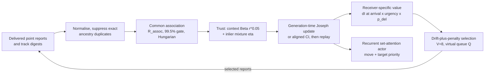
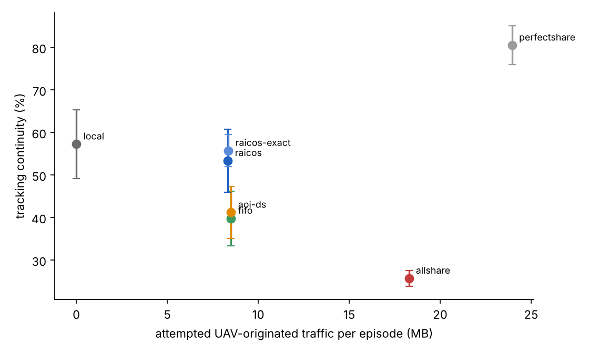

# RAI-CoS

**Reliability-Calibrated, Age-of-Information-Aware Collaborative Sensing for Resilient Multi-UAV Tracking over Intermittent Networks**

[](../../actions)
[](https://doi.org/10.3390/computers15100711)
 

This repository is a reference implementation of the framework published in:

> Md Tahmid Rashid, **Md Saikat Ahmed**, Md Jawad Siddique. *RAI-CoS: Reliability-Calibrated Age-of-Information-Aware Collaborative Sensing for Resilient Multi-UAV Tracking over Intermittent Networks.* **Computers** 2026, 15(10), 711. MDPI. https://doi.org/10.3390/computers15100711

## The problem

Multi-UAV tracking can extend coverage by combining aerial observations with reports from fixed monitors and mobile sources. On intermittent links that evidence arrives **late, duplicated and of uneven quality**, and broad sharing consumes bandwidth and energy. RAI-CoS treats reliability, time, provenance and communication cost as **one information-control problem**.

## Decision epoch (Algorithm 1)



## Implementation map

Each row is checked against the article's main text (Sections 3–5).

| Article | Module | What is implemented |
|---|---|---|
| Target dynamics and beliefs (3.2, Eqs. 3–5) | `imm.py`, `roads.py` | Four-mode IMM with constant-velocity, slow/stop, acceleration and coordinated-turn modes, and Joseph-form mode updates. Targets move on road graphs and switch among the same four regimes. |
| Report and provenance model (3.3, Eq. 6) | `sources.py`, `env.py` | Each report is a typed logical record: UUID, source, context, observation, raw covariance, source-clock generation time, confidence ξ and ancestry. Point payloads are 112 B and digests 160 B, each with a 32 B envelope. Digests carry a 16-ID provenance ledger, and every attempted byte is counted. |
| Communication, queue and age (3.4, Eqs. 7–8) | `network.py`, `env.py` | Loss, delay, jitter, bursts, blackouts and per-link capacity are modelled. Counted ACKs give per-link delivery and delay estimates, and a per-neighbour clock filter from two-way timestamps sends a sync envelope after 5 s idle. The nearest 7 peers each get one digest per epoch. Lifetimes are 30 s (5 s urgent) and the live lag is L = 15 s. |
| Reliability and confirmation (3.5, 4.3, Eqs. 9, 10, 16, 17) | `reliability.py`, `tracker.py` | Each receiver keeps forgotten Beta posteriors that back off from source–context to source to type prior (λ_shrink = 20). The exact 5th percentile is the control score. Delayed confirmations use χ²₂,₀.₉₅ against provenance-independent evidence, with forgetting ρ = 0.995. The drift statistic D (λ_D = 0.95) switches to ρ = 0.98 for 30 s after 5 confirmations above 0.35. Retention is 120 s or 256 records. |
| Report pipeline and admission (4.2, 4.4, Eqs. 11, 12, 15) | `admission.py` | `R_src = R_raw·exp(1.5(1−ξ))` and `R_time = R_src + Jσ²Jᵀ`. A 99.5% gate is followed by the uniform-on-ellipse inlier mixture η. Reports are rejected at η ≤ 0.15, downweighted below 0.65 and accepted otherwise. `R_eff = R_time / max(η, 0.05)`, with an inflation cap of 20. |
| Physical-time OOSM (4.5, Eq. 18) | `tracker.py` | A 15 s buffer of typed events and snapshots. A late report is inserted at its converted generation time, and every later event is replayed with its recorded decision. Reports past L are kept for audit only. |
| Provenance-aware fusion (4.6, Eq. 19) | `imm.py`, `tracker.py` | Exact ancestry duplicates are dropped. Otherwise CI minimises log det P_CI, using a 21-point search, golden-section refinement to 0.001 and 1e-6 I regularisation. |
| Expected information gain at arrival (4.7, Eqs. 20–21) | `scheduler.py`, `env.py` | ΔI is computed from the latest delivered receiver digest, aged to the predicted arrival time, with a generation-time correction using the sender's lower-bound R_eff. Urgency is `1 + 1.5(0.4·a_age + 0.4·a_loss + 0.2·a_cap)`. Duplicate risk combines Jaccard overlap and time proximity. `g = p_del·u·max(0,ΔI) − λ_dup·D − λ_E·Ē`. |
| Virtual-queue scheduling (4.8, Eqs. 22–23) | `scheduler.py`, `env.py` | The queue update is `Q ← max(0, Q + B_t − B̄)` and the per-epoch objective is `max Σ x(V·g − Q·ℓ)` with V = 8. Feasibility requires p_del ≥ 0.20, ΔI ≥ 0.0075 nats, link capacity and battery reserve. A deployed greedy rule uses deterministic tie-breaks, and a 16-byte-quantised exact solver (`raicos-exact`) is included as a diagnostic. |
| Belief-conditioned recurrent control (4.9) | `policy.py`, `mappo.py` | The actor encodes up to 12 target tokens through a 128-d projection and two set-attention blocks with 4 heads and a team token. UAV-state and link/queue encoders feed a 256-unit GRU with a movement head (hover/N/S/E/W, masked) and a target-priority head. A centralised critic with PopArt is trained by MAPPO (GAE, PPO clip, 32-step sequences). |
| Metrics (5.8, Eqs. 24–25) | `env.py` | Continuity requires error ≤ 20 m and tr(P) ≤ 400 m² on the fleet belief with the smallest covariance. Captures require 5 s of prioritised tracking within 20 m. Also reported: RMSE, position NEES, reacquisition time, attempted bytes, budget violation, Wh per target (145 W + 0.42·v² + 0.20·a², 2.2/1.3 µJ per byte), decision P95, and Brier, 10-bin ECE, AUROC, harmful acceptance and useful rejection. |

**What differs from the article's setup**

* **Simulator.** The article couples Eclipse SUMO, OpenStreetMap roads (Beijing, Chicago-grid, Normal) and replayed ns-3 traces. This repository uses a self-contained Python simulator with synthetic road graphs in the same three roles. `RoadMap.from_edge_list` accepts a SUMO/OSM export, and `NetworkConfig.trace_file` replays a delivery trace.
* **Scale and budget.** The article runs 8 UAVs, 10 targets, 12 monitors and 30 mobile sources, and so does this repository. The budget follows the article's rule (B̄ = 50% of the uncapped AllShare rate), which in this simulator gives 1.8 KB/s per UAV. The article's figure is 5.17 KB/s because its traffic is larger. Run `scripts/calibrate_budget.py` to recompute it.
* **Controller.** The article trains MAPPO for 5 seeds × 10 M steps in 32 environments. The full architecture and trainer are here (`scripts/train_mappo.py`), but no trained checkpoint is shipped, so benchmarks use a scripted belief-conditioned actor with the same action space. This affects every method equally.
* **Baselines.** Local, FIFO (BaseActor-FIFO), AllShare, AoI-DS-style freshness weighting and PerfectShare (oracle) are implemented. The published learned comparators (SchedNet, CACOM, VIL2C, CoDe) and the CI–GM-PHD / TC-OSPA2 trackers are not.
* **Supplement values.** Settings from the article's Supplementary Tables (source-process rates, IMM noise, λ_dup, λ_E, w_D, τ_D, type priors) use documented defaults in `config.py`, marked `[repo]`. Settings stated in the main text are marked `[paper]`.

## Results from this simulator (nominal point, 5 seeds × 600 s, scripted actor)

`python scripts/run_benchmark.py --suite nominal --seeds 0 1 2 3 4` (± is the 95% bootstrap half-width)

| Method | Continuity (%) | Captures | Position NEES (ideal 2) | Reacq. (s) | Tx (MB) | Budget violation (%) | Wh/target | Brier | ECE |
|---|---|---|---|---|---|---|---|---|---|
| local | 57.3 ± 6.8 | 10.00 | 16.42 | 14.3 ± 3.3 | 0.00 | 0.00 | 41.40 | 0.021 | 0.087 |
| fifo | 39.8 ± 5.7 | 9.40 | 116.47 | 6.5 ± 0.6 | 8.51 | 0.00 | 38.36 | 0.091 | 0.121 |
| allshare | 25.7 ± 1.7 | 8.20 | 139.72 | 8.8 ± 0.5 | 18.28 | 100.00 | 38.45 | 0.103 | 0.142 |
| aoi-ds | 41.2 ± 5.2 | 9.60 | 117.58 | 6.6 ± 1.0 | 8.51 | 0.00 | 38.67 | 0.079 | 0.108 |
| raicos | 53.4 ± 6.5 | 9.60 | 35.91 | 8.7 ± 2.7 | 8.33 | 0.00 | 38.13 | 0.073 | 0.084 |
| raicos-exact | 55.8 ± 3.1 | 9.80 | 24.68 | 6.0 ± 0.7 | 8.36 | 2.50 | 38.37 | 0.073 | 0.084 |
| perfectshare | 80.5 ± 4.0 | 9.60 | 4.53 | 4.4 ± 1.0 | 23.95 | 100.00 | 38.27 | 0.052 | 0.022 |



What the run shows:

* **Among methods that share under the byte budget, RAI-CoS tracked best.** Continuity was 53–56%, against 40% for FIFO and 41% for AoI-DS at the same traffic (about 8.4 MB), with no budget violation.
* **Its beliefs were much better calibrated:** position NEES was 25–36, against about 117 for FIFO and AoI-DS and 140 for AllShare.
* **Sharing everything without control was worst.** Uncapped AllShare reached 26% continuity at more than twice the bytes and broke the budget in every run.
* **Local-only tracking (57%) was not beaten by any deployable sharing method in this simulator**, while PerfectShare reached 80.5%. Shared evidence is valuable when links are ideal, but delayed shared evidence still adds association errors here. Closing that gap, for example with a trained MAPPO actor or a tuned association front end, is open work.
* **These are this repository's numbers, not the article's.** The article used SUMO/OSM/ns-3 and a trained MAPPO actor.

The other suites (`severe`, `ablation`, `transfer`, `drift`, and the loss × delay grid) are implemented and runnable with the commands below, but were not run for this release.


## Quick start

```bash
git clone https://github.com/Saikat09-Ahmed/RAI-CoS.git
cd RAI-CoS
pip install -r requirements.txt
pytest -q                                                      # 25 tests

python scripts/run_benchmark.py --suite nominal  --seeds 0 1 2 3 4
python scripts/run_benchmark.py --suite severe   --seeds 0 1 2 3 4
python scripts/run_benchmark.py --suite ablation --seeds 0 1 2 --duration 300
python scripts/run_benchmark.py --suite transfer --seeds 0 1   --duration 300
python scripts/run_benchmark.py --suite drift    --seeds 0 1   --duration 300
python scripts/run_grid.py --losses 0 0.2 0.4 --delays 0 2 5 --duration 300
python scripts/make_figures.py

python scripts/calibrate_budget.py                             # B_bar = 50% of uncapped AllShare
python scripts/train_mappo.py --steps 2000 --envs 2            # recurrent MAPPO actor (demo length)
python scripts/run_benchmark.py --suite nominal --methods raicos --actor learned --weights results/actor.pt
python scripts/profile_decision_stack.py                       # decision-stack latency on this host
```

## Repository layout

```
raicos/
  config.py       declared operating settings ([paper] vs [repo])
  roads.py        road graphs and four-regime road targets
  sources.py      UAV / monitor / mobile report processes, latent quality, clocks
  network.py      loss, delay, jitter, bursts, blackouts, capacity, ACK/link/clock estimation
  imm.py          four-mode IMM, Joseph update, log-det covariance intersection
  reliability.py  hierarchical forgotten Beta reliability, drift statistic
  admission.py    covariance pipeline, 99.5% gate, inlier mixture admission
  tracker.py      association, track lifecycle, generation-time replay, digests, confirmations
  scheduler.py    information gain at arrival, urgency, duplicate risk, virtual queue, exact solver
  policy.py       observation tokens, set-attention GRU actor, centralised critic with PopArt
  mappo.py        recurrent MAPPO trainer
  env.py          closed-loop episode, methods/ablations, metrics
scripts/          benchmarks, loss-delay grid, figures, budget calibration, training, profiling
tests/            unit tests (replay exactness, duplicates, CI, reliability, admission, value, solver, all methods)
```

## Citation

```bibtex
@article{rashid2026raicos,
  title   = {{RAI-CoS}: Reliability-Calibrated Age-of-Information-Aware Collaborative Sensing for Resilient Multi-{UAV} Tracking over Intermittent Networks},
  author  = {Rashid, Md Tahmid and Ahmed, Md Saikat and Siddique, Md Jawad},
  journal = {Computers},
  volume  = {15},
  number  = {10},
  pages   = {711},
  year    = {2026},
  publisher = {MDPI},
  doi     = {10.3390/computers15100711}
}
```

## Authors

Md Tahmid Rashid (School of Information Technology, Illinois State University), Md Saikat Ahmed (Department of Technology, Illinois State University, [ORCID](https://orcid.org/0009-0002-4220-4741)), Md Jawad Siddique (Department of Computer Science, Southern Illinois University).

Released under the MIT License.
